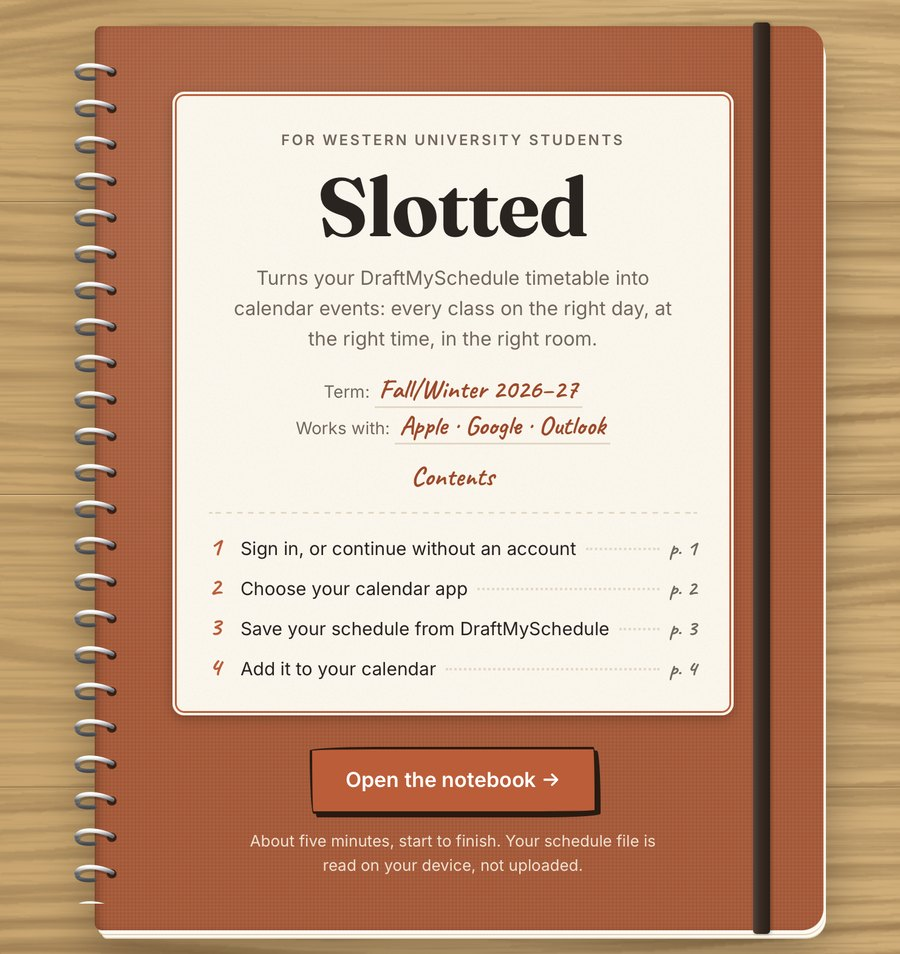
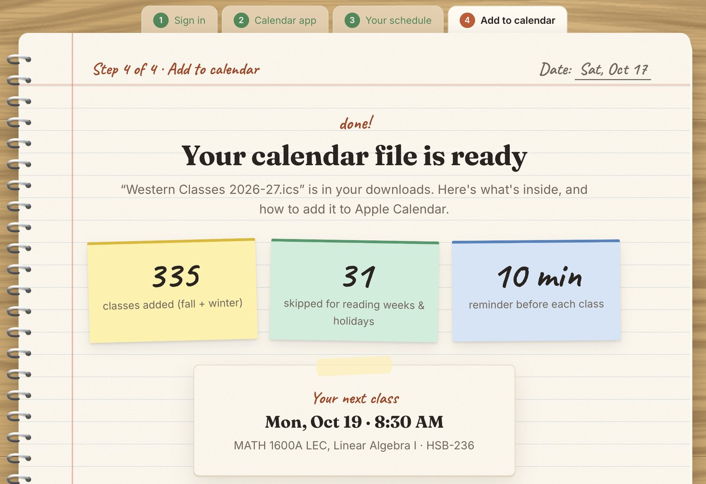

# Slotted

**Your Western timetable, in your calendar, in about five minutes.**

Slotted turns a saved DraftMySchedule page into a full term of calendar events: every lecture, lab
and tutorial on the right day, at the right time, in the right room, with reading weeks and
holidays already taken out. It works with Apple Calendar, Google Calendar, Outlook, and anything
else that opens `.ics` files.

### → [slotted.taraskoval.ca](https://slotted.taraskoval.ca)

  
  &nbsp;
  

## Why it exists

DraftMySchedule shows your timetable, but it can't send it anywhere. The usual fix is typing every
class into a calendar by hand, then remembering to delete reading week. Slotted does that part.

## How it works

1. Save your **My Current Schedule** page from DraftMySchedule.
2. Drop the file into Slotted. It's read in your browser and never uploaded.
3. Download a calendar file, or sign in and get a private link that keeps your calendar up to
   date when your classes change.

## Under the hood

- **Your file stays on your device.** The schedule page is parsed in the browser. Without an
  account, nothing is sent anywhere.
- **One calendar engine.** [`shared/ics.js`](shared/ics.js) builds both the downloaded file and
  the live calendar link, so they can't disagree. It follows Western's course-number rules
  (full-year, half-term, six-week quarter and accelerated courses) and the official term dates.
- **Self-hosted.** The API and database run in Docker on a home server, reachable only through a
  Cloudflare Tunnel.
- **Accounts done properly.** Argon2 password hashes, Google sign-in with PKCE, one-time reset
  links, rate limits, and daily backups.
- **Tested against real and tricky schedules.** Online courses, quarter courses, affiliate
  colleges, waitlists, and summer files that shouldn't be accepted.

**Built with** JavaScript (no framework) · Node.js + Express · PostgreSQL · Docker ·
Cloudflare Tunnel · GitHub Pages

| Folder | What's in it |
| --- | --- |
| [`web/`](web) | The website |
| [`shared/`](shared) | Calendar builder and term dates, used by both the website and the API |
| [`api/`](api) | Accounts, saved schedules, calendar links, problem reports |
| [`docs/OPERATIONS.md`](docs/OPERATIONS.md) | How the live server is run |

## Status

Live for the 2026–27 Fall/Winter terms. Next year's dates go in once Western publishes them.
Found something wrong? [Report a problem](https://slotted.taraskoval.ca/report.html).

Made by [Taras Koval](https://taraskoval.ca), a Computer Science student at Western. Slotted isn't
affiliated with Western University.

## License

**© 2026 Taras Koval. All rights reserved.** The code is public so you can read it. You may not
copy, modify, reuse or redistribute any part of it without written permission. See
[LICENSE](LICENSE).
