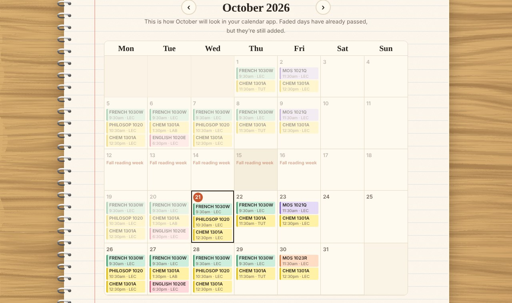
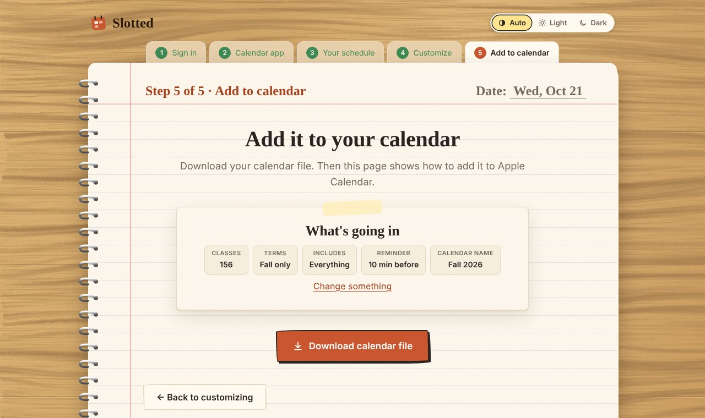
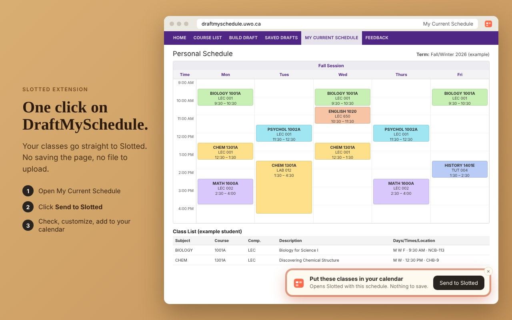
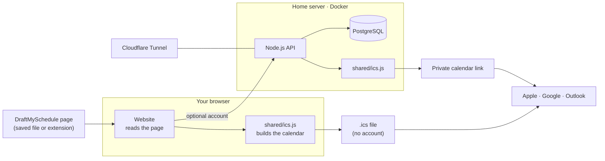

# Slotted

**Your Western University timetable, in your calendar, in around five minutes.**

[**Open Slotted →**](https://slotted.taraskoval.ca) &nbsp;·&nbsp; [Privacy](https://slotted.taraskoval.ca/privacy.html) &nbsp;·&nbsp; [Report a problem](https://slotted.taraskoval.ca/report.html)

## Overview

Slotted turns your DraftMySchedule **My Current Schedule** page into a full term of calendar
events: every lecture, lab and tutorial on the right day, at the right time, in the right room,
with reading weeks and holidays already taken out. It works with Apple Calendar, Google Calendar,
Outlook and any app that opens `.ics` files.

It's free, needs no account, and your schedule never leaves your device unless you choose to
save it.

## Contents

- [Why it exists](#why-it-exists)
- [Features](#features)
- [How it works](#how-it-works)
- [Browser extension](#browser-extension)
- [Privacy](#privacy)
- [Architecture](#architecture)
- [Project structure](#project-structure)
- [Status and roadmap](#status-and-roadmap)
- [Acknowledgements](#acknowledgements)
- [License](#license)

## Why it exists

A lot of students I know type every class into their calendar by hand. I always went looking for
a tool to do it for me instead, but the one I found felt sketchy: it had me do things I didn't
understand, and I ended up with a calendar that worked and no idea how it got there.

So I built the opposite. Slotted is free, it explains every step, and it's for anyone who just
wants their courses in their calendar each year, with no strings attached.

## Features

| | |
| --- | --- |
| **Every class, placed correctly** | Lectures, labs and tutorials on the right days and times, using Western's official term dates. Full-year, half-year, accelerated and six-week courses are all handled. |
| **Holidays and reading weeks removed** | Classes that fall on a day off are skipped automatically. |
| **Labs and tutorials your way** | Set any lab to every other week, choose its first and last day, or pick the exact days. Labs that land on a holiday move back a week. |
| **See it before you add it** | A month preview shows exactly what your calendar app will show, updated as you change your choices. |
| **Choose what goes in** | Fall, winter or both; lectures, labs or everything; a reminder before each class; your own calendar name and colour. |
| **Instructions for your app** | Every step is written for the calendar app you use: Apple Calendar, Google Calendar, Outlook or another. |
| **A calendar that updates itself** | With a free account, get a private calendar link. Update your classes in Slotted and your calendar follows. |
| **One-click import** | The optional Chrome extension sends your schedule straight from DraftMySchedule, with nothing to save or upload. |
| **Light, dark or automatic** | Follows your device, or choose your own. Works on phones and computers. |

## How it works

1. **Sign in, or continue without an account.**
2. **Choose your calendar app.** Every step after this is written for it.
3. **Get your schedule.** Save your My Current Schedule page and add the file, or use the extension
   to skip this step. Check that the classes match, then continue.
4. **Customize.** Choose the terms, what to include, lab weeks, a reminder, a name and a colour,
   with a live month preview.
5. **Add it to your calendar.** Download the calendar file, or get a link that stays up to date,
   and follow the steps for your app.

  

## Browser extension

**Slotted for DraftMySchedule** adds a **Send to Slotted** button to DraftMySchedule's My Current
Schedule page. One click opens Slotted with your schedule already loaded. It's optional: the
website works the same without it.

**[Install it from the Chrome Web Store](https://chromewebstore.google.com/detail/slotted-for-draftmyschedu/jbnmiindjkaooefolkgojlgbnbodfnkb)** (Chrome, Edge and other Chromium browsers).

- Runs only on the My Current Schedule page and on Slotted.
- Asks for a single permission (`storage`) to hand the page to the Slotted tab.
- The copied page never leaves your browser and is deleted as soon as Slotted reads it.

  

The source is in [`extension/`](extension).

## Privacy

- **No account, no data.** The schedule page is read in your browser and the calendar file is made
  on your device.
- **Accounts store only what they need:** email, an Argon2 password hash, saved schedules and your
  calendar link.
- **No ads and no tracking.** Only anonymous counts of visits and calendars made. Nothing is sold
  or shared for marketing.
- **Delete anytime.** Deleting your account removes everything, and backups within 14 days.

Read the full [privacy policy](https://slotted.taraskoval.ca/privacy.html).

## Architecture

- **One calendar engine.** [`shared/ics.js`](shared/ics.js) builds both the downloaded file and the
  calendar link, so the two always match.
- **Static website** on GitHub Pages; no framework, no build step.
- **API and database** run in Docker on a home server, reachable only through a Cloudflare Tunnel,
  with no open ports.
- **Security:** Argon2id password hashes, Google sign-in with PKCE, one-time reset links, rate
  limits, HTTPS only and daily backups.
- **Tested** against real and tricky schedules: online courses, quarter courses, affiliate
  colleges, waitlists, and files from the wrong session.

**Built with** JavaScript · Node.js + Express · PostgreSQL · Docker · Cloudflare Tunnel · GitHub Pages

## Project structure

| Path | Contents |
| --- | --- |
| [`web/`](web) | The website: pages, styles, and the schedule reader |
| [`shared/`](shared) | Calendar builder and term dates, used by the website and the API |
| [`api/`](api) | Accounts, saved schedules, calendar links and problem reports |
| [`extension/`](extension) | The Chrome extension |
| [`docs/OPERATIONS.md`](docs/OPERATIONS.md) | How the live server is run and maintained |

## Status and roadmap

Live for the **2026–27 Fall/Winter** terms. Each year's dates are added once Western publishes
them.

Planned:

- [x] Chrome Web Store release of the extension
- [ ] Edge and Firefox versions of the extension
- [ ] Adding midterms and due dates from a course outline

Found something wrong? [Report a problem](https://slotted.taraskoval.ca/report.html) or email
[slotted@taraskoval.ca](mailto:slotted@taraskoval.ca).

## Acknowledgements

Thanks to eq's [ClassMySchedule](https://github.com/jshklz/classmyschedule) (public domain), which
showed that an extension can read the schedule straight from the open page.

## License

**© 2026 Taras Koval. All rights reserved.** The code is public so it can be read and reviewed. You
may not copy, modify, reuse or redistribute any part of it without written permission. See
[LICENSE](LICENSE).

---

Made by [Taras Koval](https://taraskoval.ca), a Computer Science student at Western.
Slotted isn't affiliated with or endorsed by Western University.
